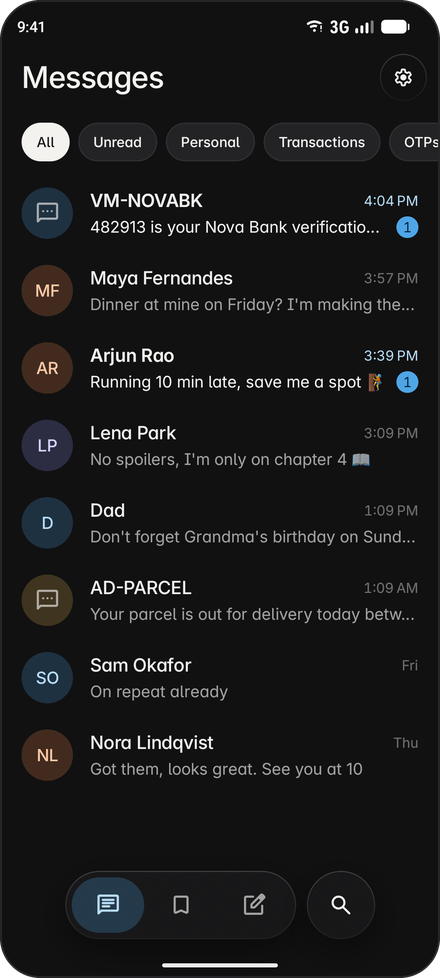
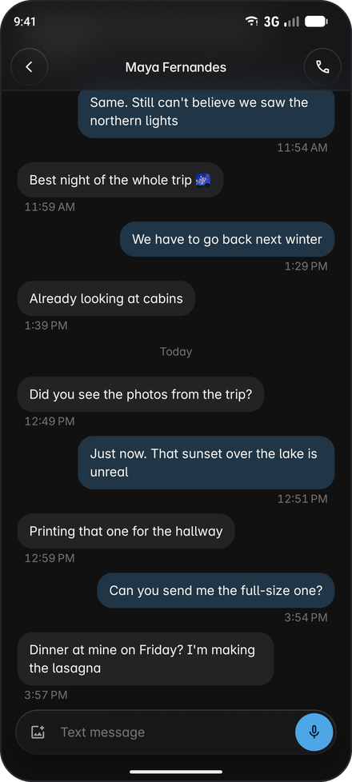
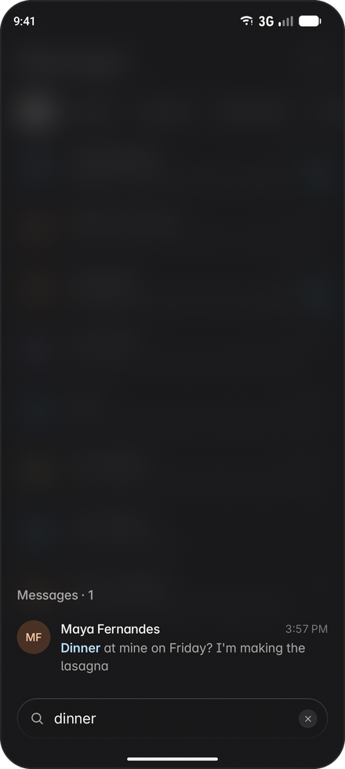
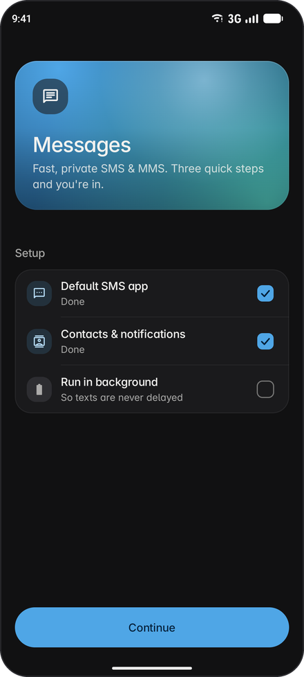
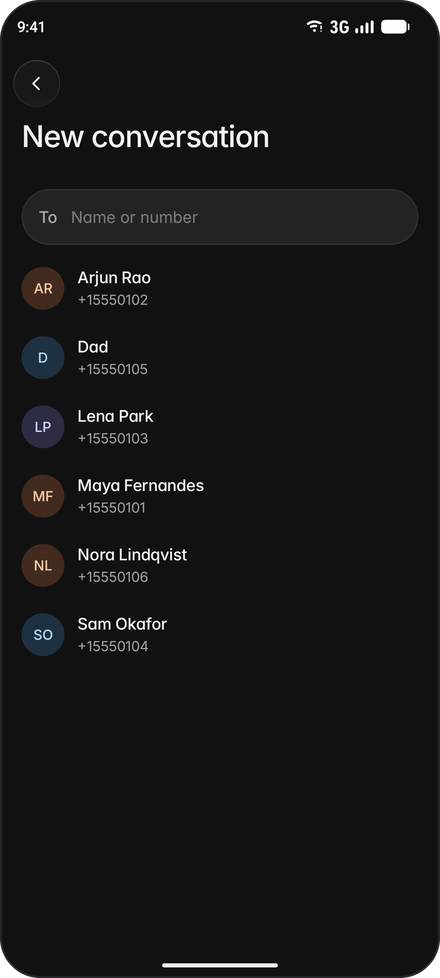
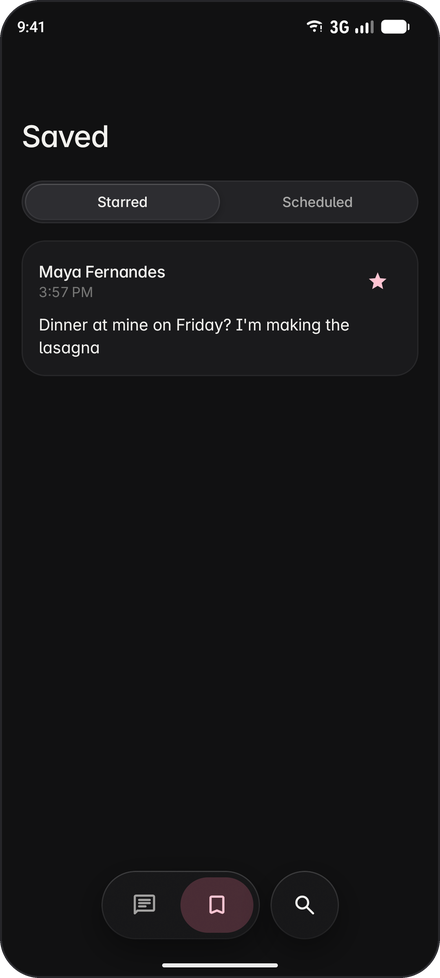
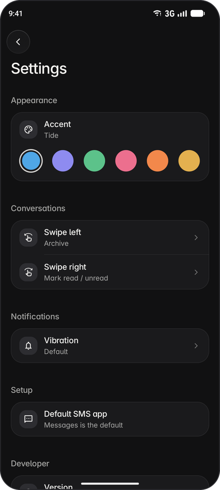
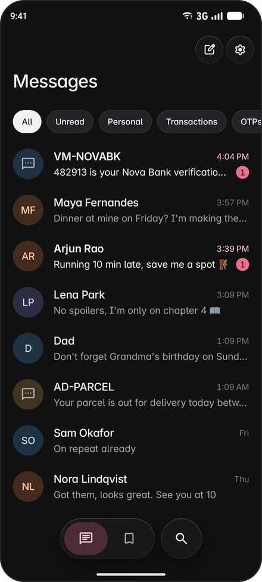

# Messages

**Open-source alternatives to the apps you use every day, except ours feel way too good.**

Messages is a free, open-source SMS and MMS app for Android. It replaces your phone's default messaging
app, and it has no internet permission, so your messages never leave the phone. It's part of
[Redfox OSS](https://github.com/Redfox-OSS) and built on the [Bedrock](https://github.com/Redfox-OSS/bedrock)
design system: dark surfaces, frosted glass with a lit rim, mid-bright colour that lives inside surfaces,
and calm motion where nothing overshoots.

This is the Bedrock edition of [Messages](https://github.com/Redfox-OSS/messages). It does everything the
original does, installs beside it (its package is `dev.redfox.messages.bedrock`), and only one of them can
be the default SMS app at a time.

<p align="center">
  <a href="https://github.com/Redfox-OSS/messages-bedrock/releases/latest"><b>Download the latest APK</b></a>
  &nbsp;·&nbsp; Android 13+ &nbsp;·&nbsp; No internet permission &nbsp;·&nbsp; GPL-3.0
</p>

<p align="center">
  
  &nbsp;
  
  &nbsp;
  
</p>

<sub>Screenshots use made-up people and messages.</sub>

## Features

- **Your existing texts.** Conversations load straight from Android's message store, so nothing is lost
  when you switch apps in either direction.
- **Delivery status.** Messages show Sending, Sent, Delivered or "Not sent · Tap to retry".
- **Search.** A full-text index on the device finds words by how they start ("pay" finds "payment") and
  numbers anywhere in a message ("4521" finds XX4521).
- **MMS photos, group texts and voice notes.** Photos are shrunk to fit your carrier's size limit; group
  replies go to everyone; voice notes record from the mic button and play inline.
- **One-time codes.** When a code arrives, a live notification shows it for a few seconds with
  tap-to-copy, and a **Copy** button sits under the message. Codes are copied as sensitive, so Android
  hides them from clipboard previews and history.
- **Starred and scheduled.** Long-press a message to star it; long-press Send to schedule one for later,
  even across reboots. Both live in the **Saved** tab.
- **Inbox your way.** Pin and archive conversations, pick what swiping left and right does (Archive,
  Delete, Read/unread, Pin, Call or nothing), or long-press to select several and mark them read or
  unread, archive or delete them at once.
- **Reply from the notification**, or mark as read without opening the app.
- **Dual SIM.** A SIM badge in the composer, and a counter for how many SMS parts a long message takes.
- **Open in app.** Links to well-known services (Play Store, YouTube, Maps, Amazon and more) get an
  "Open in …" button.
- **Your accent.** Pick any of Bedrock's six accents (Tide, Iris, Moss, Rose, Ember, Sand) in Settings.

## Screenshots

<p align="center">
  
  &nbsp;
  
  &nbsp;
  
</p>
<p align="center">
  
  &nbsp;
  
</p>

## Design

Messages follows [Bedrock](https://github.com/Redfox-OSS/bedrock)'s rules, and a build check
(`verifyDesignRules`) keeps feature code on them:

- **Frosted glass with a lit rim** for the top bar, nav bar, composer and search; scrolling content
  frosts beneath them.
- **Colour inside surfaces, never glows.** Your messages sit in a soft accent container, theirs on a
  raised surface; the one aura is the welcome card.
- **Nothing overshoots.** Every spring is critically damped; timed motion uses one calm curve. Sheets
  and dialogs ease in and out, and swipe actions settle back without a bounce.
- **An icon-only nav bar** with a pill selection you can hold and scrub across, which turns compact as
  you scroll a list.
- **Sentence case and tabular figures** everywhere, so times and counts never jitter.

## Privacy

Messages has **no internet permission**. It can't send your messages, contacts or anything else off your
phone, because Android won't let it go online. The manifest goes further and removes the permission, so a
library can't quietly add it back. MMS still works: Android's own MMS service handles the network side.

No analytics, no ads, no crash reporting, no accounts.

## Install

Messages needs **Android 13 or newer**. On first launch it asks to become the default SMS app.

Download the APK from the [Releases page](https://github.com/Redfox-OSS/messages-bedrock/releases).
Releases are signed with the same key as the original Messages; the certificate's SHA-256 is:

```
8f:cd:2c:a3:fc:50:d0:02:9e:cf:50:3b:5d:e2:73:a5:5b:00:ea:80:98:47:6b:13:6e:99:8e:59:b6:50:61:93
```

## Tech stack

| | |
|---|---|
| Language | Kotlin 2.2, coroutines and Flow |
| UI | Jetpack Compose (BOM 2026.02.01) on Bedrock 0.1.1, Haze 1.7 for the glass |
| Navigation | Navigation 3 |
| Architecture | MVI per screen (State / Intent / Effect / ViewModel), use cases in `:core:domain` |
| DI | Hilt |
| Storage | Android's SMS/MMS provider for messages; Room for the search index and your data (starred, scheduled, pinned, archived); DataStore for settings |
| Images | Coil 3, local only |
| MMS | AOSP's PDU parser and composer, vendored in `:core:mms` |
| Build | AGP 9.2, convention plugins in `build-logic/`, min SDK 33, target and compile SDK 36 |

## Build

You need JDK 17 or newer (21 for releases) and the Android SDK with compile SDK 36.1.

```bash
git clone https://github.com/Redfox-OSS/messages-bedrock.git
cd messages-bedrock
./gradlew installDebug
```

The debug build installs next to the release one (its package name ends in `.debug`). Bedrock downloads
from its Maven repository (https://redfox-oss.github.io/bedrock/maven) on the first build. To try a
Bedrock change before it's released, check Bedrock out next to this repository as `../Bedrock` and add
`-PlocalBedrock`.

`./gradlew assembleRelease` signs with the key in a git-ignored `keystore.properties` when there is one,
and leaves the APK unsigned otherwise. Published releases come from `tools/release.sh`.

### Project layout

| Path | What |
|---|---|
| `app/` | The app shell: navigation, the nav bar, settings wiring, receivers |
| `feature/*` | One module per screen: onboarding, conversations, thread, search, starred, scheduled, settings |
| `core/*` | Shared layers: model, domain (use cases), data, database (Room), datastore, telephony, MMS (vendored AOSP PDU code), contacts, UI |
| `build-logic/` | Gradle convention plugins, including the check that keeps feature code on Bedrock's design rules (tokens only, no ripples, no glows, nothing that overshoots) |
| `docs/` | How the app moved from Obsidian to Bedrock, and the README screenshots |

## Known limitations

- **No RCS.** Android doesn't let third-party apps send or receive RCS, so Messages is SMS and MMS only.
  If RCS is on for your number, people's messages may go to Google Messages instead. Turn RCS off to get
  them as SMS and MMS.
- **Business chatbot cards** that arrive as MMS are shown read-only. Their reply buttons need RCS, and
  their images aren't downloaded because the app has no internet access.
- **MMS hasn't been tested end to end on every carrier.** If MMS fails for you, please open an issue
  with your carrier and phone.
- English only for now.
- Mostly tested on a Samsung Galaxy S23. Reports from other phones are welcome.

## Contributing

Issues and pull requests are welcome. Please read the org-wide guides first:

- [Contributing](https://github.com/Redfox-OSS/.github/blob/main/CONTRIBUTING.md)
- [Security policy](https://github.com/Redfox-OSS/.github/blob/main/SECURITY.md) (please report
  vulnerabilities privately, not in issues)
- [Code of Conduct](https://github.com/Redfox-OSS/.github/blob/main/CODE_OF_CONDUCT.md)

## License

Messages is licensed under the [GNU General Public License v3.0](LICENSE). It includes AOSP's MMS PDU
code, which is Apache 2.0; see [core/mms/NOTICE](core/mms/NOTICE).
